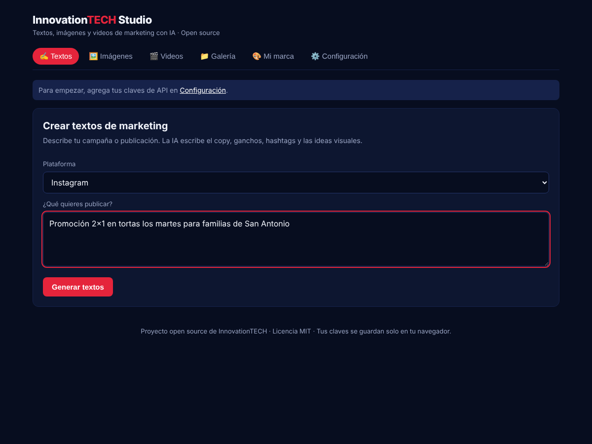
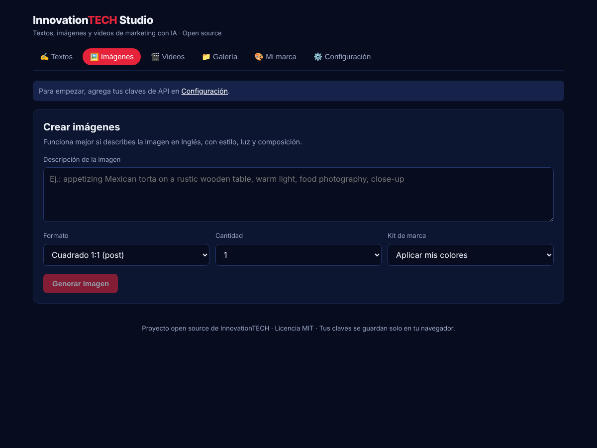
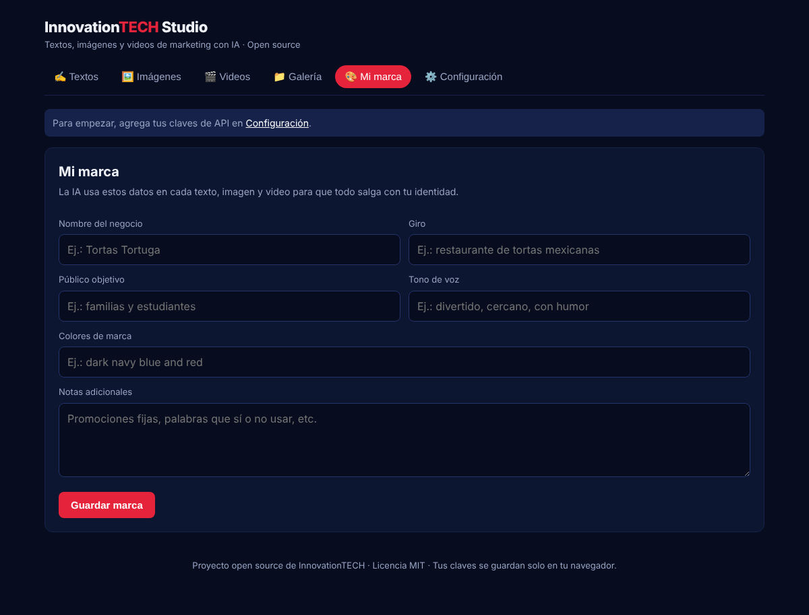

# InnovationTECH Studio

> **English:** InnovationTECH Studio is a free, open source app to create marketing content with AI — copy, images, reels and videos — with your own brand. The interface is available in Spanish and English (switch it from the side menu). See [CONTRIBUTING.md](CONTRIBUTING.md) to help.

Plataforma **open source** para crear contenido de marketing con inteligencia artificial: **textos, imágenes y videos**, todo en un mismo lugar y con la identidad de tu marca.

Cada persona usa **sus propias claves de API** y paga solo lo que genera. El código es libre (licencia MIT): cualquiera puede usarlo, instalarlo y mejorarlo.



| Imágenes | Mi marca |
|---|---|
|  |  |

## Qué puede hacer

| Módulo | Qué crea | Con qué |
|---|---|---|
| ✍️ Textos | Copys para redes, ganchos, hashtags, llamadas a la acción, ideas visuales | **Cloudflare Workers AI (gratis, Llama 3.3 70B)** o Claude de Anthropic (de pago) |
| 🖼️ Imágenes | Posts, historias, banners, fotos de producto; desde cero o **a partir de tus fotos** (hasta 4 con Cloudflare) | **Cloudflare Workers AI (gratis)** o Replicate (de pago). Formatos 1:1, 4:5, 9:16 y 16:9 |
| ✏️ Editor de imágenes | Edita cualquier imagen creada o subida: 12 filtros, ajustes (brillo, contraste, saturación, temperatura, matiz, luces, sombras, viñeta, grano, desenfoque), textos con 10 fuentes, contorno, sombra y fondo, stickers de oferta, emojis, formas, logo, marco y degradado, **quitar fondo** (logos y fondos de un color al instante; fotos con IA BiRefNet en el navegador, licencia MIT), **recortar con forma** (22 figuras: círculo, arco, squircle, corazón, estrella, flor, sello, orgánica, hoja, gota, escudo, ticket, burbuja, ola y más; estilos sticker, sombra, neón, marco desplazado y fondos de color o degradado), **borrador** (pincel con tamaño y dureza, restaurar, selección rectangular y lazo para borrar o conservar un área, zoom hasta 6x), fondo transparente, capas, deshacer/rehacer, recorte por formato (1:1, 4:5, 9:16, 16:9) y exportación PNG/JPG en alta resolución | Navegador (gratis, sin límite) |
| 🎞️ Reels (gratis) | Reels animados con tus imágenes: zoom y movimiento, transiciones, textos en pantalla, cierre con tu marca y logo, **voz en off con IA**. Se crean en el navegador, sin costo ni límite. Exporta MP4 (o WebM en algunos navegadores) | Navegador + Cloudflare Workers AI (textos, imágenes y voz gratis) |
| ✂️ Editor de video | Une videos y fotos; recortar, dividir, reordenar, duplicar, velocidad (0.5x–2x), volumen, encuadre, 8 filtros, 6 transiciones, textos animados, formatos 9:16, 1:1 y 16:9; el proyecto se guarda en el dispositivo | Navegador (gratis) |
| 🎵 Música gratis | La app **compone música original sin derechos de autor** a la medida del video, en 7 estilos (pop, lo-fi, corporativo, latino, electrónica, épico, acústico) con versiones ilimitadas; o sube tu propia canción. También en el Creador de Reels (baja sola cuando habla la voz) | Navegador (gratis) |
| 🎬 Video con IA (opcional) | Clips generados por IA desde texto o animando una foto | Modelos de video en Replicate (de pago) |
| 🎨 Mi marca | Logo, paleta de colores, letra de títulos, contacto, giro, público y tono. La IA la usa en cada pedido y en el editor y los reels se aplica con un toque | — |
| 🧩 Plantillas | 14 diseños por giro (comida, belleza, bienes raíces, tiendas, eventos, servicios) que salen con tu marca; los títulos se ajustan solos | Navegador |
| 💬 Asistente | Chat de marketing que recuerda la conversación, responde en tiempo real y acepta cambios con un toque (más corto, más formal, variantes…); dictado por voz, leer en voz alta, llevar al editor y crear la imagen; conversaciones guardadas en el dispositivo | Cloudflare Workers AI (gratis) o Claude |
| 🗓️ Calendario de contenido | Plan de 30 días con la IA: tipo de publicación, frase para la imagen, texto listo y descripción de la foto; cada día se convierte en imagen, diseño o reel; descarga para Excel | Cloudflare Workers AI (gratis) o Claude |
| 🎠 Carrusel para Instagram | La IA escribe la portada, los puntos y el cierre (4 a 10 diapositivas) y la app los diseña con tu marca: 3 estilos, formato 4:5 o 1:1, barra de avance continua, foto propia o con IA por diapositiva, ajuste fino en el editor. Descarga en .zip, compartir directo a Instagram desde el celular y texto para publicar | Cloudflare Workers AI (gratis) o Claude + navegador |
| 📐 Todos los tamaños | Un diseño adaptado a post, post vertical, historia, horizontal, Pinterest, portada de Facebook y banner de YouTube (con zona segura); descarga en .zip | Navegador |
| 💬 Subtítulos y efectos | Subtítulos automáticos de tus videos (Whisper de Cloudflare, gratis), textos palabra por palabra o con la palabra resaltada, stickers animados; subtítulos de la voz en off en los reels | Navegador + Cloudflare Workers AI |
| 🌎 Idiomas | Interfaz en español e inglés; la IA escribe en el idioma elegido | — |
| 📁 Galería | Guarda **permanentemente** en tu dispositivo todas tus imágenes, diseños y reels (IndexedDB, cientos de MB); copia los archivos para que no caduquen; filtros, vista grande, editar, descargar y eliminar | Navegador |

**Flujo 100% gratis:** en *Videos → Reel con mis imágenes*, escribe el tema y presiona **✨ Crear todo con IA**: la IA escribe los textos de cada escena, el cierre y el guion de voz, y crea las imágenes. Luego genera la voz y presiona **🎬 Crear reel**.

El flujo ideal: escribes la idea en **Textos**, la IA te da el copy y las descripciones visuales, y con un clic pasas a **Imágenes** y luego a **Videos** (incluso puedes animar la imagen que generaste).

## Privacidad de las claves

- Las claves se guardan **solo en el navegador** de cada persona (localStorage).
- En cada pedido viajan al servidor de la app, que las reenvía al proveedor y **no las almacena ni las registra**.
- Si hospedas la plataforma para otros, usa siempre HTTPS (Vercel lo incluye).

## Cómo conseguir las claves

1. **Cloudflare Workers AI (textos e imágenes gratis):** crea una cuenta gratuita en <https://dash.cloudflare.com>, entra a *AI → Workers AI → Use REST API*, copia tu **Account ID** y crea un **token de Workers AI**. Los mismos datos sirven para textos e imágenes. El plan gratuito da una cantidad de uso diaria, compartida entre textos e imágenes, que se reinicia a medianoche UTC.
2. **Anthropic (textos de pago, opcional):** crea una cuenta en <https://console.anthropic.com>, compra crédito en *Plans & Billing* y genera una API key. La suscripción de Claude.ai no incluye crédito de API.
3. **Replicate (videos, e imágenes de pago):** crea una cuenta en <https://replicate.com>, compra crédito en *Billing* y copia tu token en *Account → API tokens*.

Luego, dentro de la app, ve a **⚙️ Configuración**, elige los proveedores de textos e imágenes, pega tus claves y guarda. Con solo Cloudflare ya puedes crear textos e imágenes sin pagar nada.

> Los precios los fija cada proveedor y cambian con el tiempo; revisa sus páginas. Como referencia general, el texto es lo más barato, las imágenes cuestan centavos y el video es lo más caro.

## Opción 1: publicarla en internet (sin instalar nada)

1. Sube esta carpeta a un repositorio de **GitHub** (botón *Add file → Upload files*).
2. Entra a <https://vercel.com>, inicia sesión con GitHub y elige **Add New → Project**.
3. Selecciona el repositorio y presiona **Deploy**. No hace falta configurar nada.
4. En un par de minutos tendrás tu enlace (por ejemplo `innovationtech-studio.vercel.app`) para compartir.

> En el plan gratuito de Vercel las funciones tienen un límite de tiempo. Las imágenes y los videos funcionan porque el video se consulta por partes, pero si una imagen tarda demasiado, vuelve a intentarlo.

## Instalar la app en tu dispositivo

InnovationTECH Studio es una **app web instalable (PWA)**: se instala desde el navegador, con su propio ícono, y se abre en su ventana como cualquier app. No necesita tienda de aplicaciones.

- **Android (Chrome):** aparece el aviso *Instala InnovationTECH Studio* → **Instalar**. También: menú ⋮ → *Instalar app*.
- **iPhone / iPad (Safari):** botón **Compartir** ⬆️ → **Agregar a pantalla de inicio** → *Agregar*.
- **Windows / Mac (Chrome o Edge):** botón **Instalar** del aviso, o el ícono de instalar en la barra de direcciones. Queda en el menú Inicio / Launchpad.

Incluye íconos para todos los sistemas (favicon, iOS, Android adaptable y mosaico de Windows), accesos directos a Textos, Imágenes y Videos, y una pantalla de aviso si no hay internet.

## Opción 2: correrla en tu computadora

Necesitas [Node.js](https://nodejs.org) versión 20 o más reciente.

```bash
npm install
npm run dev
```

Abre <http://localhost:3000>.

## Cambiar de modelo

En **Configuración** puedes escribir cualquier modelo de Replicate, por ejemplo uno open source más nuevo:

- Imagen: `black-forest-labs/flux-schnell` (rápido y barato), `black-forest-labs/flux-dev`, u otro.
- Video: `minimax/video-01` por defecto; busca en <https://replicate.com/explore> la sección *video* para ver los modelos actuales.
- Texto: `claude-sonnet-5-5` por defecto; puedes usar cualquier modelo de Claude disponible en tu cuenta.

Los modelos usan el formato `dueño/nombre` o `dueño/nombre:version`. Si un modelo de video no acepta imagen inicial, deja ese campo vacío.

## Estructura del código

```
app/
  page.tsx                Pantalla principal: secciones, Textos, Imágenes, Galería, Mi marca, Ajustes
  image-editor.tsx        Editor de imágenes (Konva): plantillas, marca, capas, todos los tamaños
  bg-remover.tsx          Quitar fondo y borrador
  shape-crop.tsx          Recortar con forma
  reel-studio.tsx         Creador de reels
  video-editor.tsx        Editor de video, stickers y subtítulos automáticos
  content-calendar.tsx    Calendario de contenido
  carousel-studio.tsx     Carrusel para Instagram
  setup-wizard.tsx        Asistente para conectar Cloudflare y bienvenida
  api/text/               Textos, guiones de reel, carruseles y calendario (Cloudflare o Claude)
  api/image/              Imágenes (Cloudflare o Replicate)
  api/voice/              Voz en off (Cloudflare MeloTTS)
  api/transcribe/         Subtítulos automáticos (Cloudflare Whisper)
  api/video/              Video con IA (Replicate)
  api/cf-test/, api/status/  «Probar conexión» y modo demo
lib/
  brand.ts                Kit de marca
  editor-model.ts         Modelo del diseño, formatos y adaptación a otros tamaños
  templates.ts            Plantillas por giro
  carousel.ts             Diseño de las diapositivas del carrusel
  captions.ts             Subtítulos palabra por palabra
  video-engine.ts, reel.ts, music.ts   Video, reels y música generada
  i18n.ts, locales/en.ts  Idiomas
```

## Uso responsable

- No generes contenido con personas reales sin su permiso, ni logos o personajes de otras marcas.
- Revisa los términos de uso comercial de cada modelo antes de vender el contenido.
- Revisa siempre los textos antes de publicarlos.

## Contribuir

¡Las contribuciones son bienvenidas! Lee [CONTRIBUTING.md](CONTRIBUTING.md). Para reportar un problema usa el botón **Reportar un problema** de la app o abre un *issue* en GitHub.

Ideas abiertas:

- Más plantillas y más idiomas.
- Publicar directo en redes sociales.
- Guardar la galería en la nube (opcional).
- Más estilos de música y de subtítulos.

## Licencia

MIT © InnovationTECH. Puedes usar, copiar, modificar y distribuir este software libremente.

## Modo demo (opcional)

Para que las personas prueben la app sin configurar nada, el dueño del despliegue puede activar el modo demo con su propia cuenta gratis de Cloudflare. En Vercel → Settings → Environment Variables:

| Variable | Valor |
| --- | --- |
| `CF_ACCOUNT_ID` | Account ID de Cloudflare |
| `CF_API_TOKEN` | Token de Workers AI |
| `DEMO_LIMIT_TEXT` / `DEMO_LIMIT_IMAGE` / `DEMO_LIMIT_VOICE` | Opcional. Límite diario por persona (15 / 8 / 5 por defecto) |
| `DEMO_MODE` | Opcional. `off` lo desactiva |

El conteo es aproximado (en memoria, por IP y por día). Quien conecta su propia cuenta en **Ajustes → Conectar tu cuenta gratis** usa sus claves y no tiene los límites del demo. En el plan Workers Free, Cloudflare corta al llegar al límite diario gratuito, así que no hay cobros.
