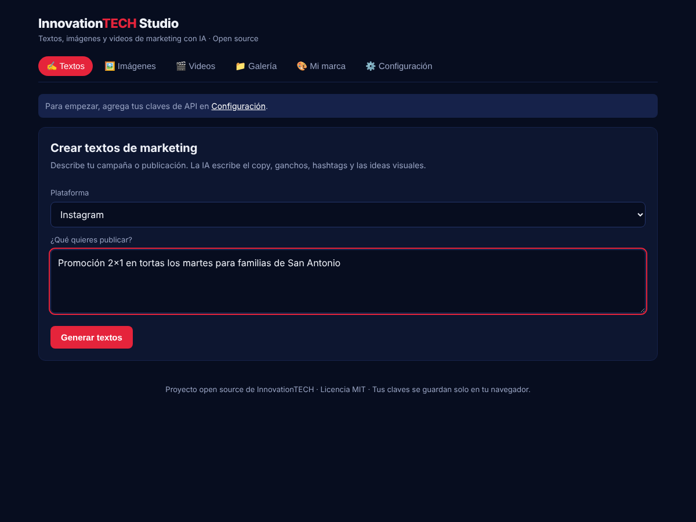
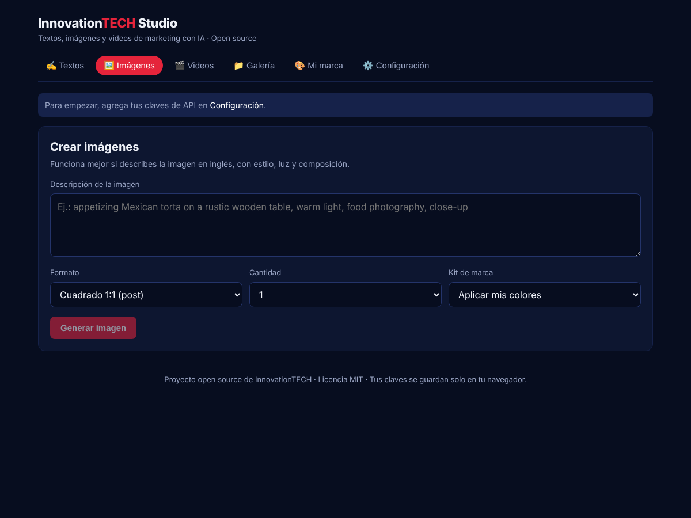
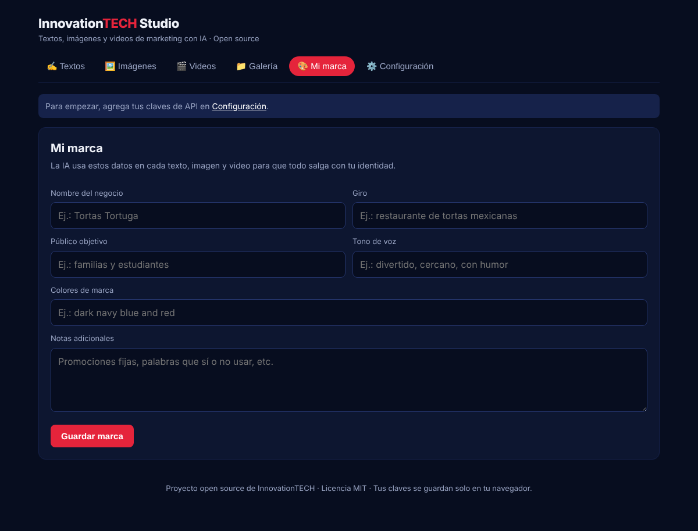

# InnovationTECH Studio

> **English:** InnovationTECH Studio is a free, open source app to create marketing content with AI — copy, images, reels and videos — with your own brand. The interface is available in Spanish and English (switch it from the side menu). See [CONTRIBUTING.md](CONTRIBUTING.md) to help.

Plataforma **open source** para crear contenido de marketing con inteligencia artificial: **textos, imágenes y videos**, todo en un mismo lugar y con la identidad de tu marca.

Cada persona usa **sus propias claves de API** y paga solo lo que genera. El código es libre (licencia MIT): cualquiera puede usarlo, instalarlo y mejorarlo.



| Imágenes | Mi marca |
|---|---|
|  |  |

## Qué puede hacer

| Módulo | Qué crea | Con qué |
|---|---|---|
| ✍️ Textos | Copys para redes, ganchos, hashtags, llamadas a la acción, ideas visuales | **Cloudflare Workers AI (gratis, Llama 3.3 70B)** o Claude de Anthropic (de pago) |
| 🖼️ Imágenes | Posts, historias, banners, fotos de producto; desde cero o **a partir de tus fotos** (hasta 4 con Cloudflare) | **Cloudflare Workers AI (gratis)** o Replicate (de pago). Formatos 1:1, 4:5, 9:16 y 16:9 |
| ✏️ Editor de imágenes | Edita cualquier imagen creada o subida: 12 filtros, ajustes (brillo, contraste, saturación, temperatura, matiz, luces, sombras, viñeta, grano, desenfoque), textos con 10 fuentes, contorno, sombra y fondo, stickers de oferta, emojis, formas, logo, marco y degradado, **quitar fondo** (logos y fondos de un color al instante; fotos con IA BiRefNet en el navegador, licencia MIT), **recortar con forma** (22 figuras: círculo, arco, squircle, corazón, estrella, flor, sello, orgánica, hoja, gota, escudo, ticket, burbuja, ola y más; estilos sticker, sombra, neón, marco desplazado y fondos de color o degradado), **borrador** (pincel con tamaño y dureza, restaurar, selección rectangular y lazo para borrar o conservar un área, zoom hasta 6x), fondo transparente, capas, deshacer/rehacer, recorte por formato (1:1, 4:5, 9:16, 16:9) y exportación PNG/JPG en alta resolución | Navegador (gratis, sin límite) |
| 🎞️ Reels (gratis) | Reels animados con tus imágenes: zoom y movimiento, transiciones, textos en pantalla, cierre con tu marca y logo, **voz en off con IA**. **Línea de tiempo**: cada foto es un clip que se mueve, se duplica o se borra, con su propia duración (1.5 a 15 s) y su texto (arriba, centro o abajo; chico, normal o grande), videos de hasta 2 minutos, deshacer y rehacer, y vista previa sin grabar. **Videos propios**: un clip puede ser un video grabado con la cámara de Studio (hasta 1 minuto, con sonido), subido (hasta 100 MB) o de tu galería; se recorta, se divide, cambia de velocidad, lleva su sonido (con interruptor y volumen) y se le puede congelar un cuadro como foto; los videos se quedan en tu dispositivo. **Tomas con IA por clip**: anima o rehace una sola foto, vuelve a la toma anterior, estira la toma (cámara lenta o repetir) y usa hasta 8 fotos animadas por video; duplicar o volver a grabar no cuesta. **Varios videos guardados**: hasta 20 proyectos con nombre en tu dispositivo, y **portada** del video terminado para descargar como imagen. **Transiciones y sonido**: seis transiciones entre clips (fundido, corte, deslizar, zoom, destello, barrido), efecto de sonido al empezar un clip y música con tu propia canción. **Exportación rápida**: los videos hechos de fotos se codifican cuadro por cuadro (WebCodecs + `mp4-muxer`), varias veces más rápido que el tiempo real; con clips de video o en navegadores sin soporte se graba en vivo como siempre. **Director con IA**: escribe o dicta una orden («hazme un video de 30 segundos de mi promo», «quita el clip 2», «baja la música») y la IA arma o corrige el video; confirma antes de gastar imágenes o voz y usa pocas imágenes de 7 a 10 s cada una. Se crean en el navegador, sin costo ni límite. Exporta MP4 (o WebM en algunos navegadores) | Navegador + Cloudflare Workers AI (textos, imágenes y voz gratis) |
| ✂️ Editor de video | Une videos y fotos; recortar, dividir, reordenar, duplicar, velocidad (0.5x–2x), volumen, encuadre, 8 filtros, 6 transiciones, textos animados, formatos 9:16, 1:1 y 16:9; el proyecto se guarda en el dispositivo | Navegador (gratis) |
| 🎵 Música gratis | La app **compone música original sin derechos de autor** a la medida del video, en **20 estilos** agrupados por ánimo: alegre (pop, house, funk disco, divertida, fiestas, corporativo), latina (latino pop, reguetón, cumbia, norteño), tranquila (bossa nova, lo-fi, acústico, inspiradora, romántica) e intensa (electrónica, hip-hop/trap, rock, épico, suspenso). Cada «otra versión» cambia tempo, tono, ritmo, instrumentos y melodía, y la canción se arma por secciones (intro, verso, coro, puente y final). También puedes subir tu propia canción. En el Creador de Reels baja sola cuando habla la voz | Navegador (gratis) |
| 🎬 Video con IA (opcional) | Clips generados por IA desde texto o animando una foto | Modelos de video en Replicate (de pago) |
| 🎨 Mi marca | Logo, paleta de colores, letra de títulos, contacto, giro, público y tono. La IA la usa en cada pedido y en el editor y los reels se aplica con un toque | — |
| 🧩 Plantillas | 14 diseños por giro (comida, belleza, bienes raíces, tiendas, eventos, servicios) que salen con tu marca; los títulos se ajustan solos | Navegador |
| 💬 Asistente | Chat de marketing que recuerda la conversación, responde en tiempo real y acepta cambios con un toque (más corto, más formal, variantes…); dictado por voz, leer en voz alta, llevar al editor y crear la imagen; conversaciones guardadas en el dispositivo | Cloudflare Workers AI (gratis) o Claude |
| 🗓️ Calendario de contenido | Plan de 30 días con la IA: tipo de publicación, frase para la imagen, texto listo y descripción de la foto; cada día se convierte en imagen, diseño o reel; descarga para Excel | Cloudflare Workers AI (gratis) o Claude |
| 🎠 Carrusel para Instagram | La IA escribe la portada, los puntos y el cierre (4 a 10 diapositivas) y la app los diseña con tu marca: 3 estilos, formato 4:5 o 1:1, barra de avance continua, foto propia o con IA por diapositiva, ajuste fino en el editor. Descarga en .zip, compartir directo a Instagram desde el celular y texto para publicar | Cloudflare Workers AI (gratis) o Claude + navegador |
| 📐 Todos los tamaños | Un diseño adaptado a post, post vertical, historia, horizontal, Pinterest, portada de Facebook y banner de YouTube (con zona segura); descarga en .zip | Navegador |
| 💬 Subtítulos y efectos | Subtítulos automáticos de tus videos (Whisper de Cloudflare, gratis), textos palabra por palabra o con la palabra resaltada, stickers animados; subtítulos de la voz en off en los reels | Navegador + Cloudflare Workers AI |
| 🌎 Idiomas | Interfaz en español e inglés; la IA escribe en el idioma elegido | — |
| 📁 Galería | Guarda **permanentemente** en tu dispositivo todas tus imágenes, diseños y reels (IndexedDB, cientos de MB); copia los archivos para que no caduquen; filtros, vista grande, editar, descargar y eliminar | Navegador |

**Flujo 100% gratis:** en *Videos → Crear video*, escribe o dicta tu idea en **¿Qué video quieres?** y presiona **Enviar**: la IA arma los clips, los textos, el cierre, el guion y la voz (confirma antes de gastar). Luego presiona **🎬 Crear reel** en la barra de abajo.

El flujo ideal: escribes la idea en **Textos**, la IA te da el copy y las descripciones visuales, y con un clic pasas a **Imágenes** y luego a **Videos** (incluso puedes animar la imagen que generaste).

## Privacidad de las claves

- Las claves se guardan **solo en el navegador** de cada persona (localStorage).
- En cada pedido viajan al servidor de la app, que las reenvía al proveedor y **no las almacena ni las registra**.
- Si hospedas la plataforma para otros, usa siempre HTTPS (Netlify lo incluye).

## Cómo conseguir las claves

1. **Cloudflare Workers AI (textos e imágenes gratis):** crea una cuenta gratuita en <https://dash.cloudflare.com>, entra a *AI → Workers AI → Use REST API*, copia tu **Account ID** y crea un **token de Workers AI**. Los mismos datos sirven para textos e imágenes. El plan gratuito da una cantidad de uso diaria, compartida entre textos e imágenes, que se reinicia a medianoche UTC.
2. **Anthropic (textos de pago, opcional):** crea una cuenta en <https://console.anthropic.com>, compra crédito en *Plans & Billing* y genera una API key. La suscripción de Claude.ai no incluye crédito de API.
3. **Replicate (videos, e imágenes de pago):** crea una cuenta en <https://replicate.com>, compra crédito en *Billing* y copia tu token en *Account → API tokens*.

Luego, dentro de la app, ve a **⚙️ Configuración**, elige los proveedores de textos e imágenes, pega tus claves y guarda. Con solo Cloudflare ya puedes crear textos e imágenes sin pagar nada.

> Los precios los fija cada proveedor y cambian con el tiempo; revisa sus páginas. Como referencia general, el texto es lo más barato, las imágenes cuestan centavos y el video es lo más caro.

## Opción 1: publicarla en internet (sin instalar nada)

1. Sube esta carpeta a un repositorio de **GitHub** (botón *Add file → Upload files*).
2. Entra a <https://app.netlify.com>, inicia sesión con GitHub y elige **Add new project → Import an existing project → GitHub**.
3. Selecciona el repositorio y presiona **Deploy**. No hace falta configurar nada: el archivo `netlify.toml` ya trae todo.
4. En un par de minutos tendrás tu enlace (por ejemplo `innovationtech-studio.netlify.app`) para compartir. Cada cambio que subas a GitHub se publica solo.

> Las funciones del servidor tienen un tope de 60 segundos. Las imágenes y los videos funcionan porque el video se consulta por partes, pero si una imagen tarda demasiado, vuelve a intentarlo.
>
> Si vas a ofrecer la app como servicio de pago, usa un plan de pago de Netlify: el plan Free se pausa al acabarse sus créditos del mes. También funciona en Vercel, pero su plan gratuito (Hobby) no permite uso comercial.

## Instalar la app en tu dispositivo

InnovationTECH Studio es una **app web instalable (PWA)**: se instala desde el navegador, con su propio ícono, y se abre en su ventana como cualquier app. No necesita tienda de aplicaciones.

- **Android (Chrome):** aparece el aviso *Instala InnovationTECH Studio* → **Instalar**. También: menú ⋮ → *Instalar app*.
- **iPhone / iPad (Safari):** botón **Compartir** ⬆️ → **Agregar a pantalla de inicio** → *Agregar*.
- **Windows / Mac (Chrome o Edge):** botón **Instalar** del aviso, o el ícono de instalar en la barra de direcciones. Queda en el menú Inicio / Launchpad.

Incluye íconos para todos los sistemas (favicon, iOS, Android adaptable y mosaico de Windows), accesos directos a Textos, Imágenes y Videos, y una pantalla de aviso si no hay internet.

## Opción 2: correrla en tu computadora

Necesitas [Node.js](https://nodejs.org) versión 20 o más reciente.

```bash
npm install
npm run dev
```

Abre <http://localhost:3000>.

## Cambiar de modelo

En **Configuración** puedes escribir cualquier modelo de Replicate, por ejemplo uno open source más nuevo:

- Imagen: `black-forest-labs/flux-schnell` (rápido y barato), `black-forest-labs/flux-dev`, u otro.
- Video: `minimax/video-01` por defecto; busca en <https://replicate.com/explore> la sección *video* para ver los modelos actuales.
- Texto: `claude-sonnet-5-5` por defecto; puedes usar cualquier modelo de Claude disponible en tu cuenta.

Los modelos usan el formato `dueño/nombre` o `dueño/nombre:version`. Si un modelo de video no acepta imagen inicial, deja ese campo vacío.

## Estructura del código

```
app/
  page.tsx                Pantalla principal: secciones, Textos, Imágenes, Galería, Mi marca, Ajustes
  image-editor.tsx        Editor de imágenes (Konva): plantillas, marca, capas, todos los tamaños
  bg-remover.tsx          Quitar fondo y borrador
  shape-crop.tsx          Recortar con forma
  reel-studio.tsx         Creador de reels
  linea-tiempo.tsx        Fila de clips del Creador de reels (mover, duplicar, borrar, duración y texto por clip)
  director.tsx            Director con IA: órdenes escritas o dictadas para armar y corregir el reel
  video-editor.tsx        Editor de video, stickers y subtítulos automáticos
  content-calendar.tsx    Calendario de contenido
  carousel-studio.tsx     Carrusel para Instagram
  setup-wizard.tsx        Asistente para conectar Cloudflare y bienvenida
  api/text/               Textos, guiones de reel, carruseles y calendario (Cloudflare o Claude)
  api/image/              Imágenes (Cloudflare o Replicate)
  api/voice/              Voz en off (Cloudflare MeloTTS)
  api/transcribe/         Subtítulos automáticos (Cloudflare Whisper)
  api/video/              Video con IA (Replicate)
  api/cf-test/, api/status/  «Probar conexión» y modo demo
lib/
  brand.ts                Kit de marca
  editor-model.ts         Modelo del diseño, formatos y adaptación a otros tamaños
  templates.ts            Plantillas por giro
  carousel.ts             Diseño de las diapositivas del carrusel
  captions.ts             Subtítulos palabra por palabra
  video-engine.ts, reel.ts, music.ts   Video, reels y música generada
  linea-tiempo.ts, historial.ts        Clips del reel y deshacer/rehacer (lógica pura, con pruebas)
  proyectos.ts            Varios videos guardados en el dispositivo (lógica pura, con pruebas)
  director.ts             Catálogo de órdenes del Director con IA: validar, aplicar y costo (lógica pura, con pruebas)
  i18n.ts, locales/en.ts  Idiomas
```

## Uso responsable

- No generes contenido con personas reales sin su permiso, ni logos o personajes de otras marcas.
- Revisa los términos de uso comercial de cada modelo antes de vender el contenido.
- Revisa siempre los textos antes de publicarlos.

## Contribuir

¡Las contribuciones son bienvenidas! Lee [CONTRIBUTING.md](CONTRIBUTING.md). Para reportar un problema usa el botón **Reportar un problema** de la app o abre un *issue* en GitHub.

Ideas abiertas:

- Más plantillas y más idiomas.
- Publicar directo en redes sociales.
- Guardar la galería en la nube (opcional).
- Más estilos de música y de subtítulos.

## Licencia

MIT © InnovationTECH. Puedes usar, copiar, modificar y distribuir este software libremente.

## Modo demo (opcional)

Para que las personas prueben la app sin configurar nada, el dueño del despliegue puede activar el modo demo con su propia cuenta gratis de Cloudflare. En Netlify → Project configuration → Environment variables (o en Vercel → Settings → Environment Variables):

| Variable | Valor |
| --- | --- |
| `CF_ACCOUNT_ID` | Account ID de Cloudflare |
| `CF_API_TOKEN` | Token de Workers AI |
| `DEMO_LIMIT_TEXT` / `DEMO_LIMIT_IMAGE` / `DEMO_LIMIT_VOICE` | Opcional. Límite diario por persona (15 / 8 / 5 por defecto) |
| `DEMO_MODE` | Opcional. `off` lo desactiva |

El conteo es aproximado (en memoria, por IP y por día). Quien conecta su propia cuenta en **Ajustes → Conectar tu cuenta gratis** usa sus claves y no tiene los límites del demo. En el plan Workers Free, Cloudflare corta al llegar al límite diario gratuito, así que no hay cobros.

## Cuentas y planes de pago

Studio puede funcionar con **cuentas de usuario** (inicio de sesión, un negocio por cuenta, planes Básico y Pro, cobro mensual con Stripe, **paquetes extra** de pago único y un panel de administración en `/admin`). Todo está **apagado por defecto**: mientras la variable `STUDIO_CUENTAS` no sea `on`, Studio funciona como siempre, sin cuentas. Puedes preparar todo con calma y encenderlo al final.

> Haz primero todo en **modo de prueba** de Stripe (dinero de mentira), en una **versión de prueba** del sitio con sus propios datos (Paso 4). El sitio principal pasa a claves reales **en la misma publicación** en que se encienden las cuentas (Paso 5).
>
> **Importante:** los dos modos de Stripe no se mezclan. Studio guarda de qué modo es cada pago y solo acepta los avisos del modo de sus claves: una suscripción pagada con tarjeta de prueba **no da plan** cuando el sitio usa claves reales (la persona tiene que pagar de nuevo), y al revés.

### Lo incluido al mes

Cada plan trae una cantidad de usos **al mes** (no por día). Se reinicia el **día 1 de cada mes a la medianoche**, hora de Texas (America/Chicago).

| Uso | Prueba (10 min) | Básico | Pro |
| --- | --- | --- | --- |
| Textos | 10 | 1,000 | 3,000 |
| Imágenes | 3 | 300 | 1,000 |
| Voces | 2 | 0 | 250 |
| Subtítulos | 2 | 0 | 250 |
| Tomas con IA (video) | 1 | 0 | 20 |

Quien conecta su **propia clave de Cloudflare** no gasta nada de esto: ese uso no se cuenta.

### Paquetes extra

Si alguien se queda sin usos antes de fin de mes, puede comprar un **paquete** (pago único, no es suscripción) desde **Mi cuenta**, en la sección **Paquetes extra**: hay un botón por paquete (por ejemplo «Creativo · +500 textos y +150 imágenes · $5»). Solo lo puede comprar el dueño del negocio, con la cuenta activa.

| Paquete | Precio | Qué da | Planes |
| --- | --- | --- | --- |
| Creativo | $5 | +500 textos y +150 imágenes | Básico y Pro |
| Voz | $9 | +100 voces y +100 subtítulos | Solo Pro |
| Video | $15 | +20 tomas con IA | Básico y Pro |

- El saldo de los paquetes **no vence**.
- Se gasta **primero lo del mes** y después el saldo del paquete.
- Si alguien pagó un paquete y no ve su saldo, agrégalo a mano en /admin con "Agregar paquete" (método "otro", nota "pago con tarjeta en Stripe").

### Cambiar la forma de pago (efectivo ↔ tarjeta)

Un cliente puede pasar de pagar a mano (efectivo, Zelle o Cash App) a pagar con tarjeta, o al revés, **sin pagar dos veces el mismo mes y sin que su cuenta se pause**. Siempre se queda con el **mismo plan**.

**De efectivo a tarjeta (lo hace el cliente):**

1. El dueño del negocio entra a **Mi cuenta** y presiona **Pasar a tarjeta**. El botón solo aparece si lo que pagó a mano vence en **2 días o más**.
2. Studio le avisa: hoy no se le cobra nada y su **primer cobro** con tarjeta será el día en que termina lo que pagó a mano. Presiona **Sí, pasar a tarjeta**.
3. Pone su tarjeta en la página de Stripe. Listo: sigue usando lo que pagó a mano y Stripe le cobra a partir de esa fecha.

Si faltan menos de 2 días, Studio le dice que podrá poner su tarjeta el día en que vence. Ese día puede elegir su plan con tarjeta normalmente.

**De tarjeta a efectivo (lo haces tú en `/admin`):**

1. Recibe el pago a mano del cliente.
2. En `/admin`, en la fila del negocio, presiona **Pasar a pago a mano**. El botón solo aparece si paga con tarjeta, su suscripción está al día y no tiene ya un pago a mano pendiente.
3. Llena el formulario (es igual al de «Activar plan»): plan, **Pagado hasta**, monto, forma de pago y nota. Arriba dice cuándo termina el mes que ya pagó con tarjeta: la fecha «Pagado hasta» tiene que ser **después** de ese día.
4. Presiona **Guardar pago a mano**. Studio le pide a Stripe que **no vuelva a cobrar** la tarjeta. El cliente usa lo que ya pagó con tarjeta hasta el fin de ese mes y después sigue con lo que pagó a mano, sin pausa.
5. En la fila aparece la nota «Pasa a pago a mano el (día) (hasta …)». Al llegar ese día, el negocio queda como pago a mano solo.

**Cambios de plan mientras tanto:** mientras la tarjeta está en su periodo gratis (hasta la fecha del pago a mano) o hay un paso a pago a mano pendiente, el cliente cambia de plan escribiéndole a InnovationTECH. Si lo cambia en el portal de Stripe durante ese tiempo, el plan nuevo empieza con el primer cobro de la tarjeta.

**Si aparece «Revisar» en rojo** («Revisar: esta suscripción volvió a renovar con un pago a mano pendiente»): la tarjeta del cliente se volvió a activar para cobrar (por ejemplo, el cliente reactivó su suscripción desde el portal de Stripe) aunque tú ya habías registrado su pago a mano. Así podría pagar dos veces. Qué hacer:

1. Entra al panel de **Stripe → Clientes**, busca al cliente y revisa su suscripción: si dice que **se va a renovar** (no dice «se cancela el…»), cobrará de nuevo.
2. Si no estás seguro de qué quiere el cliente, **contáctalo** antes de cambiar nada. Luego elige una de estas dos opciones:
   - **Si el cliente quiere seguir pagando a mano:** en Stripe, en su suscripción, vuelve a programar la cancelación **al final del periodo** (*Cancelar suscripción → al final del periodo*). No la canceles de inmediato, para no quitarle días que ya pagó con tarjeta.
   - **Si el cliente prefiere seguir con tarjeta:** en `/admin` presiona **Quitar pago a mano pendiente** y acuerda con él qué hacer con el pago a mano que ya te dio (por ejemplo, tomarlo como pago de otro mes). No toques Stripe.

**Si te equivocaste** en la fecha o el monto al pasar a pago a mano: presiona **Quitar pago a mano pendiente** y vuelve a hacer **Pasar a pago a mano** con los datos correctos. Quitar el pendiente no cambia la suscripción de Stripe (si sigue cancelada, la cuenta se pausará al terminar el mes si no vuelves a registrar el pago) y **no se anota en el Historial**: el renglón del pago original se queda ahí, así que escribe en la **Nota** del nuevo registro por qué lo corregiste.

**Cambiar de plan al mismo tiempo** (por ejemplo, de Básico en efectivo a Pro con tarjeta) no se hace desde Studio: el cliente tiene que **escribir a InnovationTECH** y tú lo ayudas a mano.

### Paso 1: Firebase (inicio de sesión)

Se usa el proyecto de Firebase `innovationtech-nova`, base `(default)`.

1. Entra a la consola de Firebase → **Authentication → Sign-in method**.
2. Activa el proveedor **Google**.
3. Activa también el proveedor **Correo electrónico/contraseña**.
4. Ve a **Authentication → Settings → Authorized domains** y agrega `innovationtech-studio.netlify.app`.
5. El correo de administrador debe estar **verificado**. Con una cuenta de Google ya lo está. Si entras con correo y contraseña, abre el enlace de verificación que te llega al correo; sin eso, `/admin` no te deja pasar.

### Paso 2: variables de entorno en Netlify

Entra a Netlify → proyecto **innovationtech-studio** → *Project configuration → Environment variables* y crea estas variables.

**Secretas** (marca *Contains secret values* cuando Netlify lo pregunte):

| Variable | Qué es |
| --- | --- |
| `FIREBASE_CLIENT_EMAIL` | Correo de la cuenta de servicio de Firebase |
| `FIREBASE_PRIVATE_KEY` | Clave privada de esa cuenta de servicio |
| `STRIPE_SECRET_KEY` | Clave secreta de Stripe (`sk_test_...` en pruebas) |
| `STRIPE_WEBHOOK_SECRET` | Secreto de firma del webhook (se obtiene en el Paso 3) |
| `CF_API_TOKEN` | Token de Workers AI de Cloudflare |
| `STUDIO_CLAVES_SECRETO` | Llave para guardar cifradas las claves de Cloudflare de los clientes (ver «Conectar la cuenta de Cloudflare del cliente») |
| `FAL_KEY` | Clave de fal.ai para las tomas con IA (ver «Videos con IA») |
| `R2_ACCESS_KEY_ID` | Clave de acceso de Cloudflare R2 (ver «Videos con IA») |
| `R2_SECRET_ACCESS_KEY` | Clave secreta de Cloudflare R2 |

**No secretas** (son datos públicos o ajustes; no son claves):

| Variable | Qué es |
| --- | --- |
| `FIREBASE_PROJECT_ID` | ID del proyecto de Firebase |
| `NEXT_PUBLIC_FIREBASE_API_KEY` | Configuración web de Firebase (es pública) |
| `NEXT_PUBLIC_FIREBASE_AUTH_DOMAIN` | Configuración web de Firebase (es pública) |
| `NEXT_PUBLIC_FIREBASE_PROJECT_ID` | Configuración web de Firebase (es pública) |
| `STUDIO_ADMIN_EMAILS` | Tu correo de administrador (varios, separados por coma) |
| `CF_ACCOUNT_ID` | Account ID de Cloudflare |
| `STUDIO_CUENTAS` | Interruptor de cuentas (ver Paso 5) |
| `NEXT_PUBLIC_STUDIO_CUENTAS` | El mismo interruptor, para las pantallas |
| `R2_ACCOUNT_ID` | Account ID de Cloudflare donde está el bucket de R2 |
| `R2_BUCKET` | Nombre del bucket de R2 (por ejemplo `studio-videos`) |
| `VIDEO_IA` | Opcional. `off` apaga al instante las tomas con IA (los reels con animación siguen funcionando) |
| `STUDIO_COLECCION_PREFIJO` | Opcional. Inicio del nombre de las colecciones de Firestore (`studio_` si no la pones). Solo para las versiones de prueba: `prueba_studio_` (ver Paso 4) |

Netlify bloquea la publicación si encuentra en el código un valor igual a una variable. Como las variables no secretas sí aparecen en el sitio, agrega una variable más:

- `SECRETS_SCAN_OMIT_KEYS` con este valor, **separado por comas y sin espacios**:

```
FIREBASE_PROJECT_ID,NEXT_PUBLIC_FIREBASE_API_KEY,NEXT_PUBLIC_FIREBASE_AUTH_DOMAIN,NEXT_PUBLIC_FIREBASE_PROJECT_ID,STUDIO_ADMIN_EMAILS,CF_ACCOUNT_ID,STUDIO_CUENTAS,NEXT_PUBLIC_STUDIO_CUENTAS,STUDIO_COLECCION_PREFIJO,R2_ACCOUNT_ID,R2_BUCKET,VIDEO_IA
```

Nunca pongas una clave secreta en una variable que empiece con `NEXT_PUBLIC_`.

### Paso 3: Stripe (modo de prueba primero)

1. Crea la cuenta en <https://dashboard.stripe.com>, registra el negocio y la cuenta de banco. Deja activado el **modo de prueba**.
2. Copia la clave secreta de prueba (`sk_test_...`) en `STRIPE_SECRET_KEY`, **solo para las versiones de prueba** (ver Paso 4). El sitio principal recibe la clave real en el Paso 5.
3. **Portal de clientes:** *Settings → Billing → Customer portal*. Configúralo así:
   - Permitir **actualizar el método de pago**.
   - Permitir **cambiar de plan** entre los dos precios de Studio (Básico y Pro).
   - Permitir **cancelar la suscripción**, con cancelación **inmediata** (no "al final del periodo") y **sin prorrateo ni reembolso**. Esto es lo que hace que, al cancelar, la cuenta se pause al instante.
4. (Opcional) *Settings → Payment methods*: activa **Cash App Pay**.
5. **Webhook:** *Developers → Webhooks → Add endpoint*.
   - URL en modo de prueba: la de tu versión de prueba, por ejemplo `https://pruebas--innovationtech-studio.netlify.app/api/stripe/webhook` (Paso 4). En modo real (Paso 5): `https://innovationtech-studio.netlify.app/api/stripe/webhook`.
   - Versión de la API: **`2026-10-28.endive`**
   - Eventos (exactamente estos siete):
     - `checkout.session.completed`
     - `customer.subscription.created`
     - `customer.subscription.updated`
     - `customer.subscription.deleted`
     - `invoice.paid`
     - `invoice.payment_failed`
     - `checkout.session.async_payment_succeeded` (acredita los paquetes pagados con banco, que tardan días)
6. Al crear el webhook, copia el **Signing secret** (`whsec_...`) en `STRIPE_WEBHOOK_SECRET` (Netlify, en el mismo contexto que su clave: el de prueba para las versiones de prueba).
7. **Preparar Stripe, antes de usar las cuentas:** entra a `/admin` con tu correo de administrador y presiona **Preparar Stripe**. Crea los precios (Básico $19 y Pro $39 al mes) y también los tres precios de los paquetes (Creativo $5, Voz $9 y Video $15). Si ya lo habías hecho antes de esta actualización, **presiónalo otra vez** para que cree los paquetes que falten (por ejemplo, Video). Hay que hacerlo una vez en cada lugar: en la versión de prueba (con la clave de prueba) y en el sitio principal (con la clave real). Si lo olvidas y alguien paga antes, Studio reconoce igual los precios por su nombre interno (`studio_basico_mensual` / `studio_pro_mensual`; los paquetes son `studio_paquete_creativo` / `studio_paquete_voz` / `studio_paquete_video`); un precio desconocido se toma como Básico.

Tarjetas de prueba (cualquier fecha futura y cualquier CVC):

- `4242 4242 4242 4242`: el pago funciona.
- `4000 0000 0000 0341`: se acepta al guardarla, pero falla al cobrar la renovación (sirve para probar la pausa por pago fallido).

### Paso 4: probar en una versión de prueba (con sus propios datos)

La versión de prueba es una copia del sitio con otra dirección. Usa **claves de prueba** de Stripe y **sus propias colecciones** en Firestore, así nada de lo que pruebes (tarjetas de prueba, negocios de prueba) llega al sitio principal.

**a) Crear la versión de prueba (branch deploy).** Una *rama* (branch) es una copia del código en GitHub con otro nombre.

1. En Netlify: *Project configuration → Build & deploy → Continuous deployment → Branches and deploy contexts → Configure*. En **Branch deploys** elige *Let me add individual branches*, escribe `pruebas` y guarda.
2. En GitHub crea una rama llamada `pruebas` (en la página del repositorio: botón de ramas → escribe `pruebas` → *Create branch*). Cada vez que subas cambios a esa rama, Netlify la construye sola.
3. Su dirección será `https://pruebas--innovationtech-studio.netlify.app`. Agrégala en Firebase (*Authentication → Settings → Authorized domains*: `pruebas--innovationtech-studio.netlify.app`).

**b) Variables solo para la versión de prueba.** En *Project configuration → Environment variables*, al crear o editar una variable elige **Different value for each deploy context** (un valor distinto por contexto). Así se pone un valor en **Branch deploys** (y en **Deploy Previews**, las versiones que Netlify arma para cada *pull request*) sin tocar **Production** (el sitio principal):

| Variable | Production (sitio principal) | Branch deploys y Deploy Previews |
| --- | --- | --- |
| `STRIPE_SECRET_KEY` | `sk_live_...` (en el Paso 5) | `sk_test_...` |
| `STRIPE_WEBHOOK_SECRET` | el del webhook real (Paso 5) | el del webhook de prueba |
| `STUDIO_COLECCION_PREFIJO` | (vacía) | `prueba_studio_` |
| `STUDIO_CUENTAS` / `NEXT_PUBLIC_STUDIO_CUENTAS` | `off` hasta el Paso 5 | `on` |

Las demás variables (Firebase, Cloudflare, administrador) pueden tener el mismo valor en todos los contextos. Después de cambiar variables, vuelve a construir la versión de prueba (sube un cambio a la rama `pruebas` o usa *Deploys → Trigger deploy*).

**c) Probar.** En la versión de prueba entra a `/admin` y presiona **Preparar Stripe**. Luego prueba: registrarte con Google y con correo, la prueba de 10 minutos, pagar Básico, mejorar a Pro, invitar a un miembro, una tarjeta rechazada (se pausa), pagar para reactivar, cancelar (se pausa) y activar a mano con Cash App.

**Prueba de un paquete:** con la cuenta en Básico o Pro, entra a **Mi cuenta**, en **Paquetes extra** presiona el botón **Creativo** y paga con la tarjeta `4242 4242 4242 4242`. Al volver, revisa que el **saldo** en Mi cuenta muestre +500 textos y +150 imágenes, y que `/admin` muestre ese mismo saldo en el negocio. Si la cuenta es Pro, repite con **Voz** (+100 voces y +100 subtítulos).

### Paso 5: encender las cuentas en el sitio principal (con claves reales)

Todo en **una sola publicación**: el sitio principal nunca debe tener las cuentas encendidas con claves de prueba (un pago con tarjeta de prueba no debe convertirse en un plan gratis).

**Antes del lanzamiento:** revisar los Términos y la Política de privacidad (`lib/legal.ts`) con un abogado o contador antes de cobrar en modo real; si cambias el fondo, sube `VERSION_LEGAL`. Se leen sin iniciar sesión en `/terminos` y `/privacidad` (por ejemplo `https://innovationtech-studio.netlify.app/terminos` y `https://innovationtech-studio.netlify.app/privacidad`): Stripe pide esas dos direcciones al activar el modo real. Las cuentas nuevas aceptan los dos documentos al crear su negocio o unirse a un equipo, y guardan la versión que aceptaron.

**Reglas de Firestore:** el proyecto de Firebase (compartido con NOVA) debe negar todo acceso desde el navegador (`match /{document=**} { allow read, write: if false; }`). Studio solo lee y escribe desde el servidor; la Política de privacidad lo afirma. Revisado y publicado el 8 de noviembre de 2026.

1. En Stripe, cambia a **modo real** y crea el webhook real (mismos siete eventos, incluido `checkout.session.async_payment_succeeded`, misma versión de la API) con la URL `https://innovationtech-studio.netlify.app/api/stripe/webhook`. Si antes creaste un webhook de prueba con esa misma URL, bórralo.
2. En Netlify, en el contexto **Production**, pon a la vez: `STRIPE_SECRET_KEY` = `sk_live_...`, `STRIPE_WEBHOOK_SECRET` = el *Signing secret* del webhook real, `STUDIO_CUENTAS=on` y `NEXT_PUBLIC_STUDIO_CUENTAS=on`. No pongas `STUDIO_COLECCION_PREFIJO` en Production.
3. **Vuelve a publicar** el sitio (*Deploys → Trigger deploy*). Las variables que empiezan con `NEXT_PUBLIC_` se fijan al construir el sitio; si solo las cambias, no pasa nada hasta la nueva publicación.
4. Entra a `/admin` del sitio principal y presiona **Preparar Stripe** (los precios reales, paquetes incluidos, son distintos de los de prueba).
5. Haz una prueba rápida: entra, crea un negocio y revisa `/admin`.
6. **El día del lanzamiento (no antes):** en Cloudflare activa **Workers Paid** (esto sí tiene costo: lo pagas tú, revisa el precio en Cloudflare antes de activarlo) y crea una **alerta de gasto** (*Billing → Notifications*), para enterarte si el uso crece. Antes del lanzamiento no hace falta.
7. Para **apagar** todo: pon `STUDIO_CUENTAS` y `NEXT_PUBLIC_STUDIO_CUENTAS` en `off` (o bórralas) y publica de nuevo.

### Conectar la cuenta de Cloudflare del cliente (opcional)

Cada negocio puede conectar **su propia cuenta gratis de Cloudflare** una sola vez. Desde ese momento Studio usa la IA de esa cuenta para todo el equipo del negocio, **sin los límites del mes** y sin gastar sus paquetes.

- **Quién la conecta:** solo el dueño del negocio. En **Mi cuenta → Tu cuenta de Cloudflare (opcional)** presiona **Conectar Cloudflare**: se abre el mismo asistente de siempre (crear la cuenta, copiar el Account ID y crear el token). Al final, Studio prueba la clave y la guarda **cifrada** (con un candado digital) en la cuenta, no en el navegador.
- **Si ya tenía la clave en su dispositivo:** Mi cuenta muestra **Guardar en tu cuenta**. La sube a la cuenta y la borra del navegador.
- **Las demás personas del equipo** no tienen que hacer nada: ven «Tu negocio usa su propia cuenta de Cloudflare.».
- **Desconectar:** en Mi cuenta, **Desconectar**. Studio vuelve a usar la IA de InnovationTECH con los límites del plan.
- Studio nunca muestra el token; solo los últimos 4 caracteres del Account ID (por ejemplo, «cuenta …a1b2»).

**Lo que tienes que hacer tú una vez:** crear en Netlify la variable `STUDIO_CLAVES_SECRETO` (es la llave del candado). Créala para **todas las publicaciones** (Production, Deploy Previews y Branch deploys) y marca **Contains secret values**. Para inventar el valor, abre **PowerShell** en tu computadora (menú Inicio → escribe «PowerShell»), pega este comando y presiona Enter:

```powershell
$b = New-Object byte[] 32; [Security.Cryptography.RandomNumberGenerator]::Create().GetBytes($b); [Convert]::ToBase64String($b)
```

Copia el texto que aparece (termina en `=`) y pégalo como valor de la variable. No lo compartas con nadie. Puedes usar un valor distinto para las versiones de prueba y para el sitio principal. Después, vuelve a publicar el sitio.

- **Si falta la variable:** los clientes no pueden conectar su Cloudflare (verán «Falta configurar el guardado seguro de claves. Avísale a InnovationTECH.»). Todo lo demás sigue funcionando.
- **Si la cambias después:** las claves que ya estaban guardadas **dejan de poder leerse**. Esos clientes vuelven a usar la IA de InnovationTECH con los límites del plan y en Mi cuenta ven «Tu Cloudflare conectado ya no se puede leer. Conéctalo otra vez.». Tienen que conectarla de nuevo. Por eso, cámbiala solo si crees que alguien la vio.

### Videos con IA (fal.ai + Cloudflare R2)

En el **Creador de Reels**, el cliente puede marcar de 1 a 4 fotos «Con IA»: cada una se convierte en una **toma de 5 segundos con movimiento real** generada en [fal.ai](https://fal.ai). El resto del video (10, 15, 20 o 30 s) sigue siendo la animación gratis del navegador. La **vista previa es gratis**; solo «Generar con IA» gasta tomas. Necesita las cuentas encendidas.

| | Prueba (demo) | Básico | Pro |
| --- | --- | --- | --- |
| Tomas incluidas | 1 | 0 (puede comprar el paquete Video) | 20 al mes |
| Modelo | MiniMax H3 Max Turbo a 480P | MiniMax H3 Max Turbo a 768P | MiniMax H3 Max Turbo a 768P |
| Costo para InnovationTECH por toma | ≈ $0.13 | ≈ $0.20 | ≈ $0.20 |

Protecciones que ya vienen puestas (se pueden cambiar en Firestore, documento `studio_config/planes`, campo `videoIa`):

- **Tope de gasto de $5 al día** para todo Studio (hora de Texas). Al llegar, las tomas esperan en fila y salen al día siguiente. El demo se detiene antes, al 80% ($4), para dejar lugar a los clientes que pagan.
- Máximo **3 tomas al mismo tiempo** en fal.ai; los de Pro pasan primero, luego los de paquete y al final el demo.
- Si una toma falla, se reintenta **una vez**; si vuelve a fallar, se **devuelve la toma** al cliente y esa foto queda con animación normal.
- La misma foto con el mismo movimiento no se cobra dos veces (se guarda el clip).
- **Interruptor:** pon `VIDEO_IA` en `off` en Netlify y vuelve a publicar para apagar la IA de video al instante.

**Cómo prepararlo (una sola vez):**

1. **fal.ai:** crea la cuenta en <https://fal.ai>, agrega crédito de prepago (por ejemplo $10) y deja **apagada la recarga automática**: así el gasto nunca pasa de lo que cargaste. En *API Keys* crea una clave y pégala en Netlify como `FAL_KEY` (secreta).
2. **Cloudflare R2 (donde se guardan fotos y clips):** en Cloudflare → *R2* → *Create bucket*, nombre `studio-videos` (privado, sin acceso público). Ponlo en `R2_BUCKET` y tu Account ID en `R2_ACCOUNT_ID`.
3. En *R2 → Manage API tokens* crea un token con permiso **Object Read & Write** solo para ese bucket. Copia *Access Key ID* y *Secret Access Key* en `R2_ACCESS_KEY_ID` y `R2_SECRET_ACCESS_KEY` (secretas).
4. En el bucket → *Settings → CORS policy*, pega esto (cambia el dominio si usas otro; agrega el de tu versión de prueba si la usas):

   ```json
   [
     {
       "AllowedOrigins": ["https://innovationtech-studio.netlify.app"],
       "AllowedMethods": ["GET", "PUT"],
       "AllowedHeaders": ["content-type"],
       "MaxAgeSeconds": 3600
     }
   ]
   ```

5. En el bucket → *Settings → Object lifecycle rules*, agrega una regla: prefijo `demo/`, **borrar a los 30 días**. Ahí van las fotos y clips de las pruebas gratis.
6. Vuelve a publicar el sitio y, en `/admin`, presiona **Preparar Stripe** otra vez para que cree el precio del paquete **Video** ($15).
7. **Prueba:** entra con una cuenta en prueba, sube 2 fotos al Creador de Reels, marca una «Con IA» y toca **Generar con IA**. Debe pasar por «Subiendo…», «En fila», «Toma 1 de 1 · Generando…» y terminar con el video listo (suele tardar de 1 a 3 minutos).

Notas:

- fal.ai avisa a Studio cuando termina cada toma en `/api/video-ia/aviso` (no hay que configurar nada en fal: la dirección va en cada pedido). Studio revisa la firma de fal en cada aviso.
- Una tarea programada de Netlify (`netlify/functions/video-ia-respaldo.mts`, cada 5 minutos, solo en el sitio principal) empuja la fila por si se pierde un aviso.
- Los archivos de R2 son privados: el navegador solo recibe enlaces temporales de una hora.
- Mientras falten `FAL_KEY` o las variables de R2, «Generar con IA» responde que los videos con IA están en pausa y el resto de Studio no cambia.

### Cómo usar `/admin`

- **Activar a mano:** para quien paga en efectivo o con Cash App. Al vencer la fecha, el negocio se pausa solo.
- **Pausar / Reactivar:** ojo, **Pausar en un negocio que paga con tarjeta no dura**: el próximo aviso de Stripe lo vuelve a activar. A esos clientes pausa o cancélalos desde el panel de Stripe.
- **Agregar paquete:** le suma a un negocio el saldo de un paquete (por ejemplo, si pagó en efectivo). Solo deja elegir los paquetes de su plan (Voz es solo para Pro).
- **Quitar saldo:** resta saldo a un negocio. Úsalo si le devuelves el dinero a alguien: los reembolsos no quitan el saldo solos.
- No se puede activar a mano un negocio cuya suscripción de tarjeta todavía puede cobrar (activa, con pago pendiente o en pausa en Stripe): primero cancélala en Stripe.
- **Pasar a pago a mano:** para quien paga con tarjeta y quiere pasarse a efectivo. Ver «Cambiar la forma de pago».

### Limitaciones conocidas

- La **galería** y **Mi marca** siguen guardándose en el dispositivo, no en la cuenta. Si varias personas usan el mismo aparato, verán lo mismo. Al **cerrar sesión** no se borra nada, salvo que marques la casilla de «otras personas usan este dispositivo» (borra la galería, «Mi marca» y las claves propias de ese navegador). Si entra **otra cuenta** en el mismo dispositivo, Studio borra las claves propias que había y pregunta si también la galería y «Mi marca». Cambiará con la Parte 2 (Memoria en la nube).
- Para cuidar las lecturas gratis de Firestore (compartidas con NOVA), la cuenta se vuelve a leer cada 5 minutos solo con la pestaña a la vista, al volver a ella y después de cada acción.
- El inicio de sesión con Google por redirección, en la app instalada del iPhone, a veces vuelve sin sesión. En ese caso usa correo y contraseña.
- El dictado con subtítulos (respaldo cuando el navegador no dicta) es solo del plan Pro.
- La cuota gratuita diaria de Cloudflare puede acabarse con muchos clientes; por eso, el día del lanzamiento hay que pasar al plan de pago de Workers (ver Paso 5).
- En el pago de los **paquetes** no actives el **impuesto automático** ni los **códigos de promoción** de Stripe: el sistema solo acredita el saldo si el monto pagado es exactamente el del paquete ($5, $9 o $15).
- Antes del primer cliente: Netlify plan Personal ($9) y consultar a un contador sobre el impuesto de ventas de Texas.
